<h1 align="center">
<picture>
  <source media="(prefers-color-scheme: dark)" srcset="./assets/typing-dark.svg">
  
</picture>
</h1>

<h3>  Alexander Sanford (Patcharapol Pantawee) | 💻 Computer Science Student @ KKU |  TH 👋</h3>

<h3 align="center">About me</h3>

  I'm Alexander, born 2006, living in Khon Kaen, Thailand, and studying Computer Science at KKU.
  Outside of coursework I build things because I'd rather understand a system than just use it —
  that curiosity is most of what shows up in these repos.

  This profile is a collection of my progress, from my humble beginnings to everything yet to come.

<h3 align="center">Contact</h3>

  

  alexander.sanford.contact@pm.me

  

